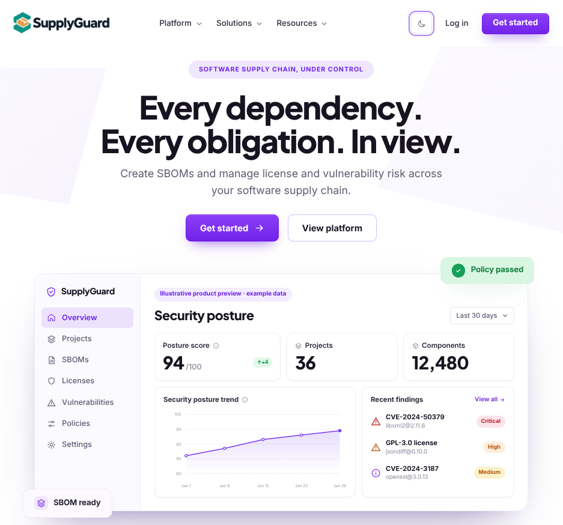
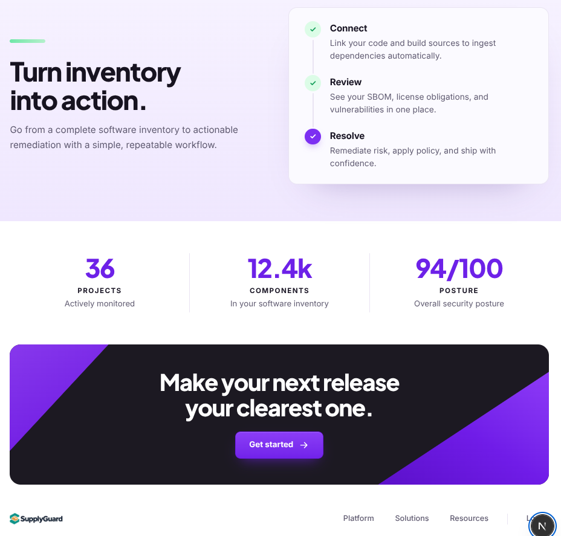
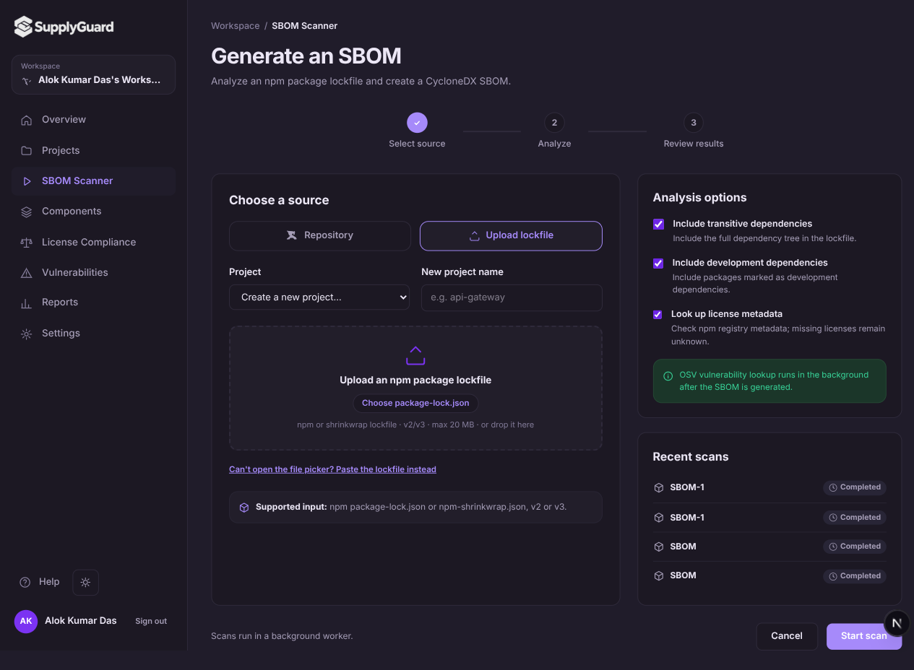
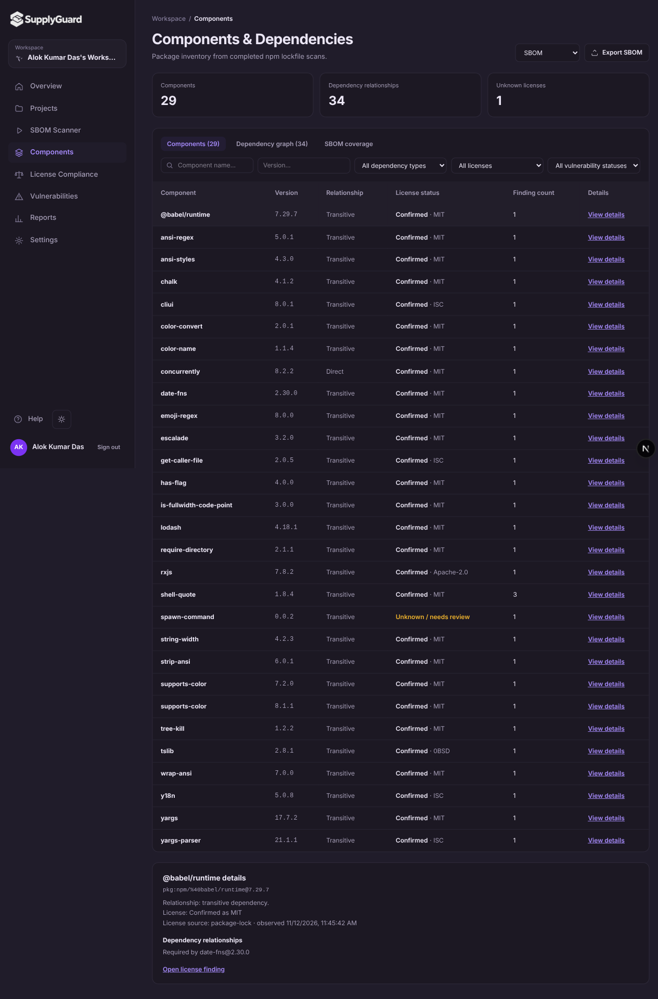
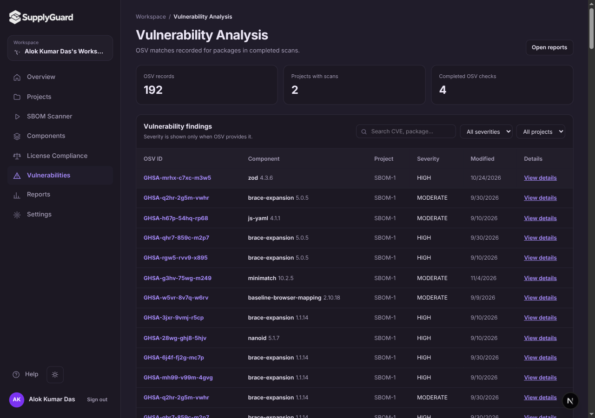
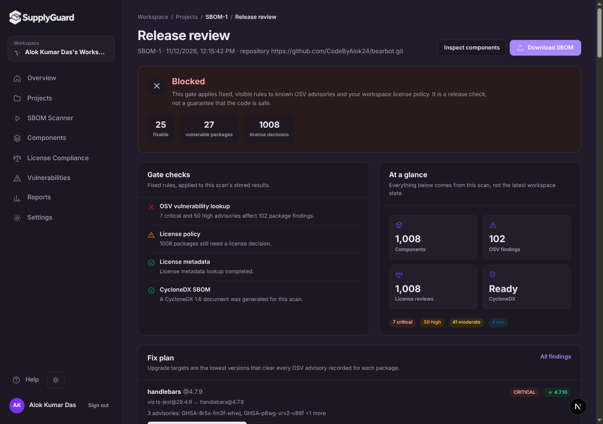
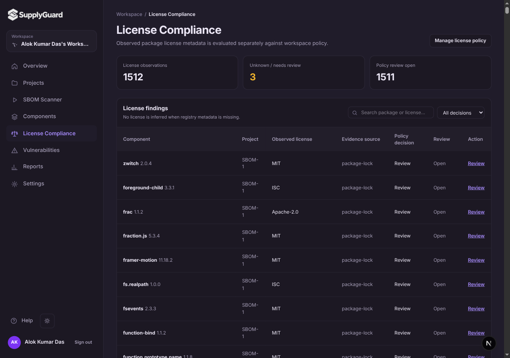
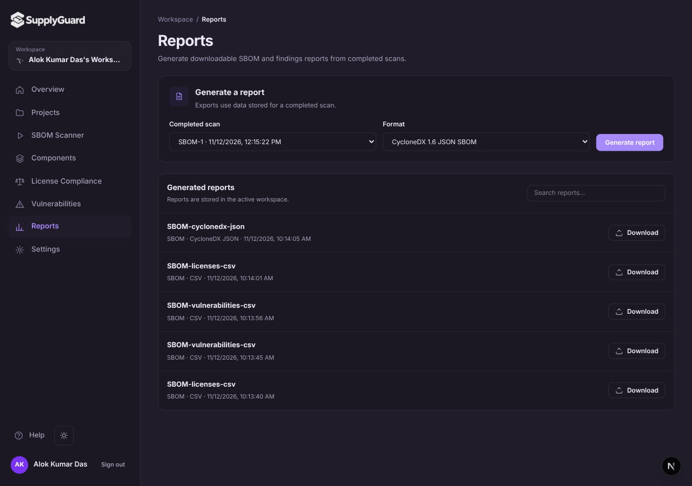
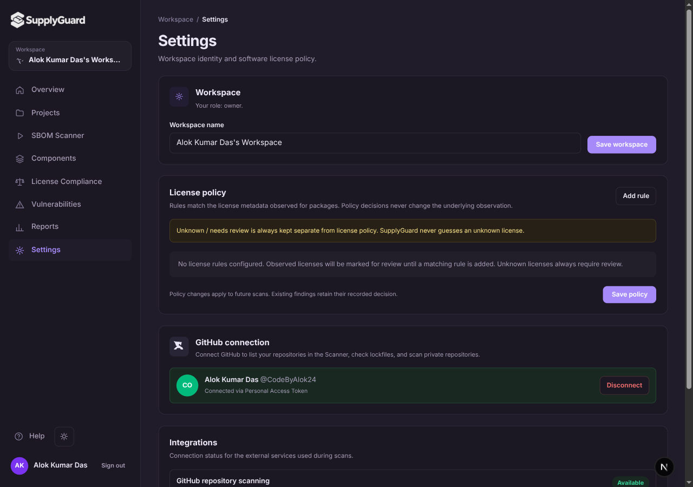

# SupplyGuard

**Every dependency. Every obligation. In view.**

A self-hosted platform that scans a Node.js project, builds a complete inventory of
every package inside it (the **Software Bill of Materials**), and tells the team
exactly what is risky — which component carries a known vulnerability, which one
breaks your license policy, and what to change to ship safely.

Built for small engineering teams who need an answer to the question auditors and
customers keep asking:
> *“Can you prove that the software you are about to ship is free of publicly
> documented security holes and license surprises?”*


*Figure 1 — Landing hero (light theme). The product preview panel is labeled illustrative sample data.*


*Figure 1b — Workflow section and CTA band: the see–prioritize–remediate loop SupplyGuard is built around.*

---

## Contents

- [What it does](#what-it-does)
- [Screenshots](#screenshots)
- [Quick start](#quick-start)
- [Repository tour](#repository-tour)
- [How scanning works](#how-scanning-works)
- [Key features](#key-features)
- [API surface](#api-surface)
- [Environment variables](#environment-variables)
- [Project scripts](#project-scripts)
- [Data model at a glance](#data-model-at-a-glance)
- [Honest limits & known issues](#honest-limits--known-issues)
- [Documentation](#documentation)
- [Troubleshooting](#troubleshooting)

---

## What it does

Modern software is assembled from hundreds of packages, not written line by line.
SupplyGuard answers, per project:

| Question | How |
|---|---|
| What is inside our software? | CycloneDX 1.6 SBOM from `package-lock.json` (or `npm-shrinkwrap.json`) |
| Is anything known-vulnerable? | OSV.dev query per package — severity, advisory IDs, fix versions |
| Are we allowed to use this? | Workspace **license policy**: allow / block / needs-review decisions |
| Which change put this risk here? | Interactive **dependency tree** with direct/transitive paths |
| Can we ship this release? | **Release review**: a defensible READY / REVIEW / BLOCKED verdict + fix plan |
| Is our SBOM trustworthy? | **SBOM coverage** check: SBOM vs lockfile, with per-gap scoring |
| What changed since last time? | **Change review**: new/resolved advisories, added/removed packages, license changes |

Everything is computed **offline, on your machine**, from your lockfile and public
advisory data (OSV + npm registry). No source code ever leaves your network unless
you scan a public repository.

---

## Screenshots

### Scanner — pick a source, get a live progress tree

*Upload a lockfile or scan a public GitHub repository. The background worker reports
real progress — Lite package → license resolution → OSV findings — instead of a fake spinner.*

### Components — full inventory + dependency tree

*Filterable package inventory (name, version, relationship, license, findings) and a
visual dependency graph rooted at your direct dependencies, with expand/collapse and worst-severity badges.*

### Vulnerability Analysis — severity at a glance

*Every OSV match, filterable by severity and project — with a severity distribution
chart and an **Impact tree** tab showing each vulnerable package where it sits in the dependency tree.*

### Release Review — the ship/no-ship decision

*Fixed, visible rules decide the verdict; the fix plan names current → target version
and a copyable `npm install …` command for each fixable package; change review diffs against the previous scan.*

### License Compliance — policy you can defend

*Observed license (with source), workspace policy verdict, reviewer notes. Unknown
licenses stay amber until a human decides — never guessed.*

### Reports & Settings

*Generate and download CycloneDX SBOMs (JSON) and CSV reports (licenses, vulnerabilities).
Reports are stored per workspace.*


*Workspace identity, license policy editor, GitHub connection (OAuth or PAT), and live integration status.*

---

## Quick start

**Requirements:** Node.js ≥ 20.9 · npm · PostgreSQL 18 · git (for repository scans)

```bash
# 1. PostgreSQL (Arch/CachyOS — on Debian/Ubuntu use your postgresql package instead)
sudo pacman -S postgresql
initdb -D ~/.local/share/supplyguard/pgdata --locale=C.UTF-8 --encoding=UTF8 --auth=trust -U postgres

# 2. Dependencies (two independent packages — frontend & backend)
npm --prefix frontend install
npm --prefix backend  install

# 3. Environment files
cp backend/.env.example  backend/.env
cp frontend/.env.local.example  frontend/.env.local

# 4. Database schema (fresh database only)
npm run db:deploy      # or: npm run db:migrate   (dev migrations)

# 5. Run — each starts PostgreSQL automatically if not already running
npm run dev            # frontend  → http://localhost:3000
npm run dev:api        # API       → http://localhost:4000/api/v1   (also starts PostgreSQL)
npm run dev:worker     # background scan worker
```

**Demo login** (works on the seeded database): ask the project owner for the demo credentials. Change the account password after publishing this repository — never commit real passwords.

Useful DB commands (cluster lives at `~/.local/share/supplyguard/pgdata`, outside `/tmp`):

```bash
npm run db:start     # start PostgreSQL  (auto-called by dev:api / dev:worker)
npm run db:status    # cluster status
npm run db:stop      # stop PostgreSQL (data persists)
npm run db:psql      # open a psql shell on the supplyguard database
```

---

## Repository tour

```
Cloud - SBOM/
├─ README.md                    ← you are here
├─ package.json                 ← root proxy scripts (dev / build / lint / db:*)
├─ docker-compose.yml           ← optional: pinned postgres:16-alpine service
├─ scripts/ensure-db.sh         ← idempotent PostgreSQL auto-starter
├─ backend/                     ← Express + Prisma + pg-boss worker
│  ├─ api.ts                    ← REST API (/api/v1), ~50 routes
│  ├─ auth.ts                   ← JWT cookie sessions, bcrypt, role checks
│  ├─ scanner.ts                ← lockfile parser · OSV · license · tree builder
│  ├─ scan-review.ts            ← verdict gate + fix plan + scan diff
│  ├─ sbom-compare.ts           ← SBOM-vs-lockfile coverage engine
│  ├─ worker.ts                 ← pg-boss job consumer (background scans)
│  ├─ mailer.ts                 ← Gmail SMTP (reset emails)
│  ├─ prisma/schema.prisma      ← 16 models
│  └─ prisma/migrations/        ← applied migrations
├─ frontend/                    ← Next.js 16 (App Router) + Tailwind CSS 4
│  ├─ src/app/                  ← routes (landing, auth, workspace, scans/[id])
│  ├─ src/components/           ← one feature folder per section
│  └─ src/lib/api.ts            ← typed API client used by every page
├─ docs/
│  ├─ PROJECT-REPORT.md         ← full academic-style project report
│  ├─ PRESENTATION.md           ← 12-slide Marp deck
│  ├─ API.md                    ← every endpoint, request/response semantics
│  ├─ SUPPLYGUARD-PLAN.md       ← architecture, roadmap, AWS phase
│  └─ screenshots/              ← real captures of the running app
└─ backups/                     ← pg_dump backups (git-ignored? no — verify before sharing)
```

---

## How scanning works

```
lockfile / repo clone
        │
        ▼
┌───────────────────────────────┐
│  Analyze components           │  parse `packages{}`, resolve purl, split direct vs transitive
├───────────────────────────────┤
│  License metadata             │  lockfile-recorded licenses first; npm registry for gaps
├───────────────────────────────┤
│  OSV lookup                   │  POST /v1/querybatch (≤1000/req) → per-ID detail fetch
├───────────────────────────────┤
│  Finalize                     │  CycloneDX 1.6 SBOM (components + dependency graph) stored on the job
└───────────────┬───────────────┘
                ▼
        PostgreSQL (user-managed cluster)
        · users · workspaces · members · projects · scans
        · components · dependency edges · license findings · OSV findings · reports
```

Background stages (`queued → source → analyze → licenses → OSV → finalize`) are
persisted to the `ScanJob.stage` column and polled by the UI — the progress you
see is real, not animated.

---

## Key features

- **Landing & auth** — dark/light themed marketing site; register, login, logout; **Google + GitHub OAuth** and **PAT-based GitHub connection**; forgot/reset password (reset emails send only if SMTP is configured); JWT in an HttpOnly cookie; role-gated API (OWNER/ADMIN/ANALYST/VIEWER).
- **SBOM Scanner** — upload `package-lock.json`/`npm-shrinkwrap.json` (v2/v3, ≤ 20 MB) or paste its contents; or scan a public GitHub repo. Live vertical progress tree shows per-package stage (clone → analyze → licenses → OSV).
- **Components** — filterable inventory (search, version filter, type, license, vulnerability status), per-package details panel, **dependency graph** tab with expand/collapse and worst-severity badges.
- **SBOM coverage** — upload any CycloneDX SBOM, compare against the scanned lockfile: coverage score with a **visible formula** (`matched ÷ total × 100`), missing components / missing relationships / missing metadata, each with an explanation.
- **Vulnerability Analysis** — full OSV match list with **severity distribution chart** and **Impact tree** tab (dependency graph with advisory badges, project-scoped).
- **License Compliance** — observed license + source per package, policy decisions (ALLOW/BLOCK/REVIEW), reviewer notes, policy editor.
- **SBOM reports** — generate & download CycloneDX JSON and CSV (licenses / vulnerabilities) on demand; stored per workspace.
- **Release Review** — ship verdict computed from **fixed, visible rules**: any critical/high advisory or blocked license ⇒ **BLOCKED**; missing metadata, partial OSV/license checks or moderate/unrated findings ⇒ **REVIEW**; otherwise **READY**. Includes the **fix plan** (current → target version + copyable command), the **change review** (diff vs previous scan), and **dependency paths** for every vulnerable package (“why is this here?”).
- **Workspace & projects** — multi-tenant data model (all queries workspace-scoped); project CRUD with the latest scan linked per project.
- **Theming & responsive layout** — full light/dark mode (CSS custom properties, no flash-of-wrong-theme); zero horizontal overflow at 375 / 768 / 1440 px; mobile drawer navigation.

---

## API surface

Over 40 endpoints, all under `http://localhost:4000/api/v1`, all workspace-scoped.
Full contract in **[docs/API.md](docs/API.md)** — highlights:

| Method & path | Purpose |
|---|---|
| `POST /auth/register · /auth/login · /auth/logout` · `GET /auth/me` | Sessions (JWT cookie) |
| `POST /projects` · `GET /projects` · `PATCH/DELETE /projects/:id` | Projects |
| `POST /projects/:id/scans` (multipart) · `POST …/scans/repository` | Start a scan |
| `GET /scans/:id` · `GET /scans/:id/review` · `GET /scans/:id/sbom` | Job status · verdict · SBOM download |
| `GET /projects/:id/components` | Inventory + dependency edges + per-package OSV hits |
| `GET /vulnerabilities/findings` · `PATCH /licenses/findings/:id/review` | Findings UI |
| `POST /sbom-uploads` · `POST /scans/:id/compare` · `GET /comparisons/:id[/report]` | SBOM-vs-lockfile coverage |
| `POST /reports` · `GET /reports/:id/download` | CycloneDX & CSV exports |
| `GET/PUT /settings/license-policies · /settings/workspace` | Policy & workspace |

---

## Environment variables

### Backend (`backend/.env`)

| Variable | Purpose |
|---|---|
| `DATABASE_URL` | `postgresql://supplyguard:…@localhost:5432/supplyguard?schema=public` |
| `JWT_SECRET` | ≥ 32 random characters; signs session cookies |
| `API_PORT` | API port (default `4000`) |
| `FRONTEND_ORIGIN` | Allowed CORS origin (default `http://localhost:3000`) |
| `SMTP_HOST · SMTP_PORT · SMTP_USER · SMTP_PASS · SMTP_FROM` | Password-reset email (Gmail app password; **currently rejected** — see limits) |
| `GOOGLE_CLIENT_ID · GOOGLE_CLIENT_SECRET · GOOGLE_CALLBACK_URL` | Google OAuth |
| `GITHUB_CLIENT_ID · GITHUB_CLIENT_SECRET · GITHUB_CALLBACK_URL` | GitHub OAuth |
| `GIT_PROVIDER_TOKEN` | Optional — enables private-repo scans via the API |

### Frontend (`frontend/.env.local`)

| Variable | Purpose |
|---|---|
| `NEXT_PUBLIC_API_URL` | API base URL (default `http://localhost:4000/api/v1`) |

> **Secrets live here on purpose.** They boot the database and the session signer — they
> cannot live inside the database. App *data* (users, hashes, projects, findings) lives in PostgreSQL.

---

## Project scripts

Root-level (`npm run …`) proxies to `frontend/` and `backend/`:

| Script | What it does |
|---|---|
| `dev` / `build` / `start` / `lint` | Next.js dev server · production build · serve · eslint |
| `dev:api` / `start:api` | Express API — **auto-starts PostgreSQL** first |
| `dev:worker` / `start:worker` | Background scan worker |
| `db:start` / `db:status` / `db:stop` / `db:psql` | Manage the PostgreSQL cluster |
| `db:generate` / `db:migrate` / `db:deploy` | Prisma client · dev migration · deploy migrations |
| `typecheck:api` | `tsc --noEmit` on the backend |

---

## Data model at a glance

`User` → `WorkspaceMember` → `Workspace` → `Project` → `ScanJob` → `Component` / `DependencyEdge` / `LicenseFinding` / `VulnerabilityFinding` → `Report` → `ReviewDecision` · plus `GitHubConnection`, `SbomUpload`, `SbomComparison`, `LicensePolicy`, `RoleScore`… see `backend/prisma/schema.prisma` for the full picture (16 models).

Everything is scoped by `workspaceId`; every API lookup enforces it server-side.

---

## Honest limits & known issues

- **Email is not verified working** — Gmail rejects the current app password (`535-5.7.8 BadCredentials`). Password-reset links are logged to the server console instead of emailed. Fix: regenerate the Gmail app password, or point `SMTP_*` at Mailtrap/SendGrid.
- **GitHub sign-in** — client configured, redirect works; full OAuth round-trip not yet confirmed by the owner; `prompt` handling adjusted. **GitHub PAT** connection (Settings → paste classic token with `repo` scope) works today.
- **Google sign-in** — OAuth consent screen is in **Testing** mode; only listed test users can sign in today.
- **Unknown licenses are never guessed.** Missing advisory severities are shown as “Unrated”, never invented. A `BLOCKED` verdict is computed from fixed, visible rules — not from an AI.
- **OSV covers published advisories only.** A `READY` verdict means *no known* critical/high advisories and *no blocked licenses* — it does not prove the code is safe.
- **Data lives in** `~/.local/share/supplyguard/pgdata` (PostgreSQL 18 cluster, user-managed, port 5432, localhost-only). It survives reboots and `/tmp` wipes; `backups/` holds `pg_dump` snapshots. The earlier `/tmp`-hosted database was unrecoverable after a system temp-dir wipe — backups are now mandatory before risky operations.
- **No cloud deployment.** AWS (ECS/Fargate/RDS/S3/SQS) is designed but not provisioned — everything runs on `localhost`.

---

## Documentation

| Doc | Audience |
|---|---|
| [docs/PROJECT-REPORT.md](docs/PROJECT-REPORT.md) | Academic / engineering report — architecture, model, testing |
| [docs/PRESENTATION.md](docs/PRESENTATION.md) | 12-slide project pitch (Marp) |
| [docs/API.md](docs/API.md) | Every endpoint with semantics & errors |
| [docs/SUPPLYGUARD-PLAN.md](docs/SUPPLYGUARD-PLAN.md) | Architecture, phases, AWS roadmap |
| [docs/screenshots/](docs/screenshots) | Real captures of the running app |

---

## Troubleshooting

| Symptom | Fix |
|---|---|
| `ECONNREFUSED …:5432` | `npm run db:start` (or any backend command — they start it) |
| API “listening” but queries hang | `npm run db:status`; if down: `npm run db:start` |
| `docker: permission denied` | Not needed — PostgreSQL runs as a user cluster; Docker is optional (`docker-compose.yml` pinned) |
| Google sign-in fails with `fetch failed` | Transient/network or IPv6 route missing; retried automatically by the backend |
| `535-5.7.8 BadCredentials` | Regenerate the Gmail app password, or switch SMTP provider |
| Scan stuck at *License metadata* | npm registry unreachable — licenses show “unknown”; scan still completes on package-lock data |
| Stale CSS in dev | Restart dev server; Turbopack cache |

---

*SupplyGuard — Every dependency. Every obligation. In view.*
