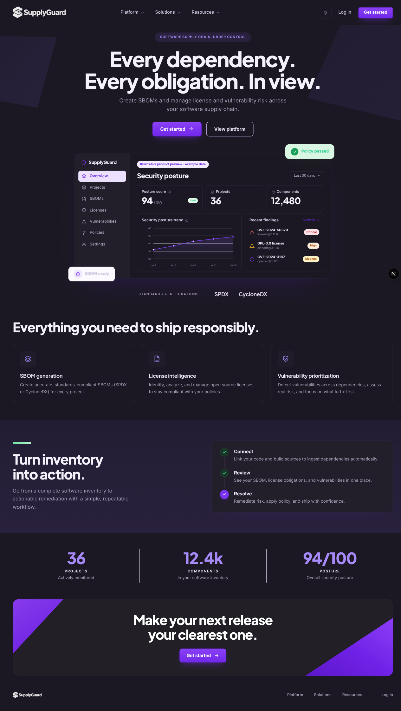
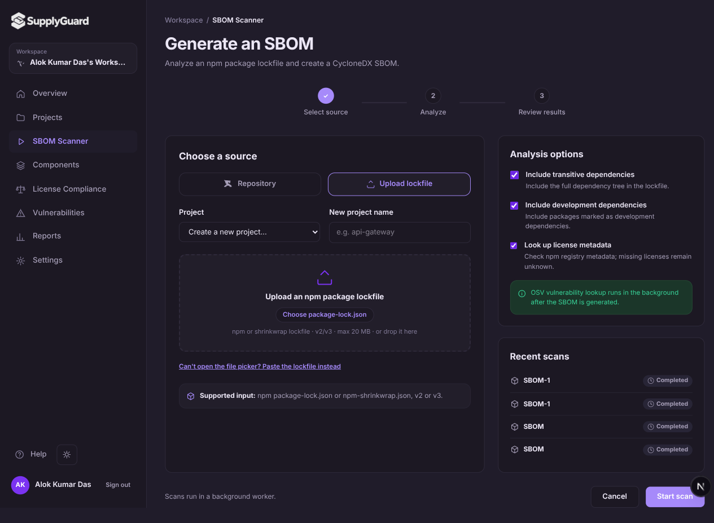
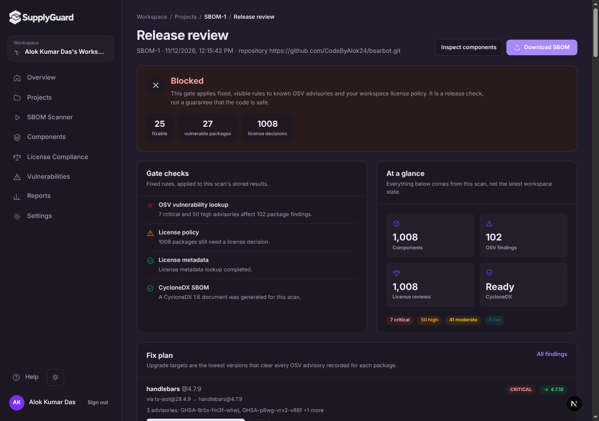

# SupplyGuard
### Every dependency. Every obligation. In view.

**Alok Kumar Das**
Software Bill of Materials · License Policy · Deployment-aware risk (manual evidence phase shipped)

<br/>



---

## Why this exists

> "Can you promise me that the software you are about to ship is free of known, publicly documented security holes — and that no license in it will force us to give away our source code?"

**Nobody can answer that today.** Not because the answer doesn't exist — because assembling it is a full-time job nobody wants to do.

---

## The problem, in three acts

1. **Invisibility** — a typical Node.js product ships with 500–1500 transitive packages. No human knows them all.
2. **The silent bomb** — `shell-quote@1.8.4` (pulled in transitively by `concurrently`) ships a **critical RCE** and a **high DoS**. You only find out when it is exploited.
3. **The legal trap** — a single copyleft license hidden 3 levels deep can obligate you to publish your proprietary source code.

---

## The product: one scan, one report

```
package-lock.json ──► SupplyGuard ──► CycloneDX SBOM (1.6)
                       │
                       ├─► Dependency graph (visual, rooted at your direct deps)
                       ├─► OSV advisory lookup (per package, with fix versions)
                       ├─► License policy verdict (allow / block / needs-review)
                       └─► Release Review: READY · REVIEW · BLOCKED  + fix plan
```

**Live demo:** `github.com/CodeByAlok24/HAQMS` scanned on a developer machine → 162 findings, 1 critical, fix one command away.

---

## Feature tour



- **Scanner** — upload lockfile or scan a public GitHub repo; real-time **vertical progress tree** with per-package status, license resolution and advisory counts, live.
- **Components** — filterable inventory; **interactive dependency tree** with expand/collapse, severity badges, legend.
- **SBOM coverage** — upload any CycloneDX SBOM; compare against the lockfile; a *visible* coverage score with per-gap explanations. Zero invented numbers.

---

## Feature tour (continued)



- **Release Review** — the differentiator:
  - Verdict computed from **fixed, visible rules** (critical/high → BLOCKED; moderate/unknown → REVIEW; all-clear → READY)
  - **Fix plan**: current → target version with copyable `npm install` command
  - **Change review**: diff vs the previous scan (new / resolved advisories, added / removed / upgraded packages, license changes)
  - **Dependency path**: "why is this here?" — e.g. `concurrently@8.2.2 → shell-quote@1.8.4`
- **Reports** — CycloneDX JSON, licenses-CSV, vulnerabilities-CSV; stored, searchable, downloadable.

---

## Architecture at a glance

| Layer | Stack |
|---|---|
| Frontend | Next.js 16 · React 19 · Tailwind 4 |
| Backend | Express 5 · REST `/api/v1` |
| Jobs | pg-boss worker (background scan) |
| Data | PostgreSQL 18 · Prisma · 18 models |
| Auth | bcrypt + JWT HttpOnly cookie |
| External | OSV API · npm registry · GitHub OAuth/PAT |

Self-hosted. No third-party SaaS holding your package list.

---

## Live numbers from this system

| Metric | Value |
|---|---|
| Components scanned | 29 (demo) · ~350 (HAQMS repo) |
| Dependency edges | 34 |
| OSV findings | 14 (demo) · 162 (repo) |
| License observations | 1,527 rows |
| Scan time | < 30 s |
| Coverage check | perfect SBOM 100 · sabotaged 75 — every gap detected |

---

## Why this matters

- **Compliance** — SBOMs are now mandatory in US federal procurement and most enterprise vendor reviews.
- **Speed** — one command answers the audit question.
- **Self-hosted** — your dependency list never leaves your infrastructure.
- **Actionable** — not a report dump; a decision and a patch.

---

## What it honestly is — and what it is not

**Is:** a self-hosted MVP, every flow exercised locally end-to-end (smoke-tested and unit/integration-tested); not independently audited.

**Is not:** a certified production platform. No cloud deployment yet (documented, requires AWS credentials). SMTP unverified. OAuth round-trip pending. Research novelty claimed: **none** — integration of known techniques, exceptionally well-engineered.

**Next:** deploy to AWS · automatic deployment/telemetry ingestion (manual evidence + manual SLO display shipped Nov 2026 — no live telemetry) · publishable evaluation of the SBOM-completeness comparison.

---

## Thank you

**Every dependency. Every obligation. In view.**


Questions?
