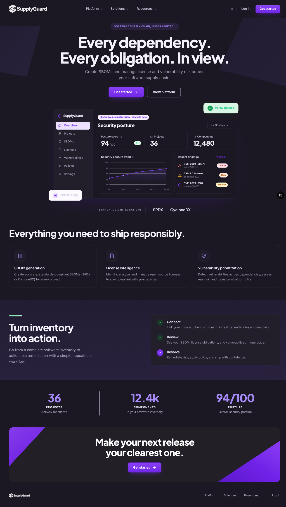
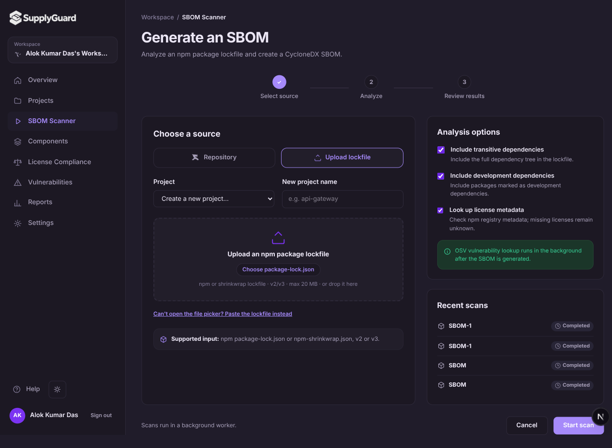
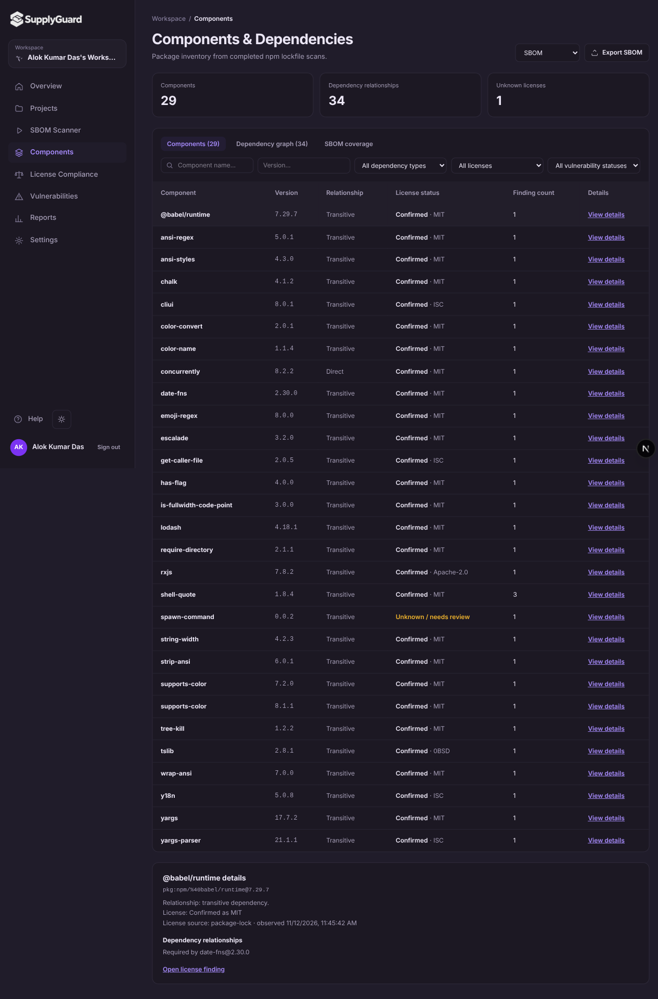
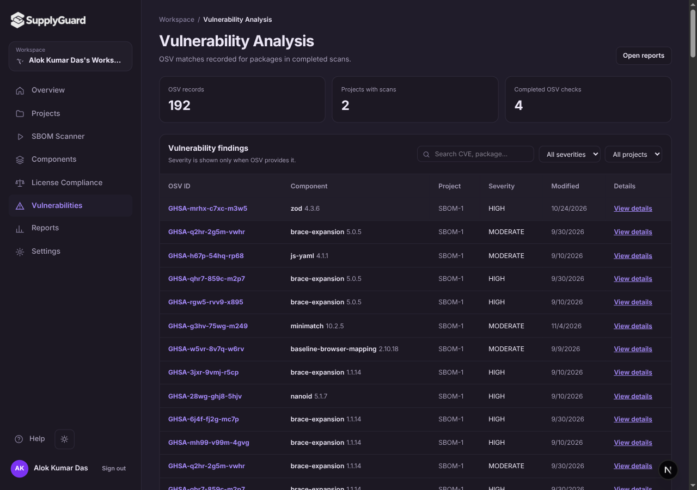
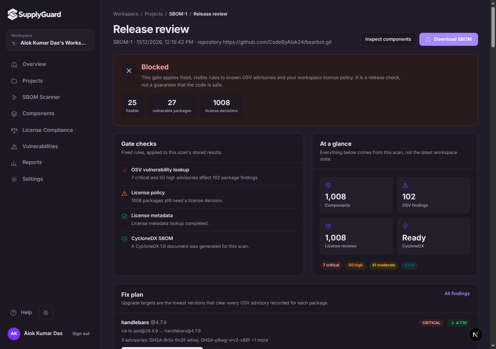
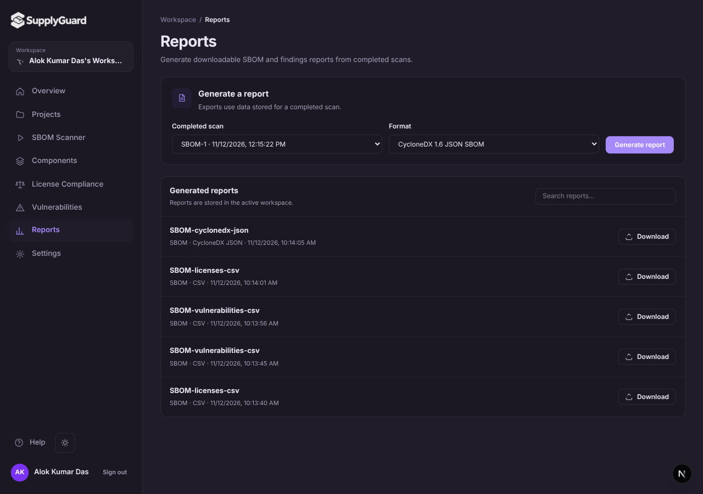
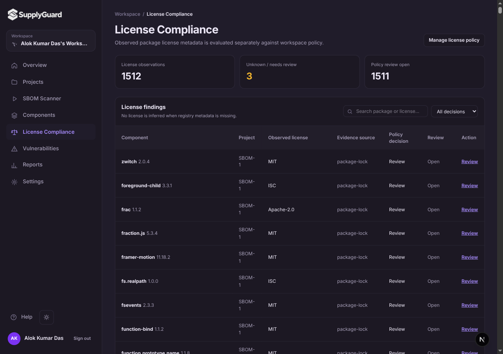
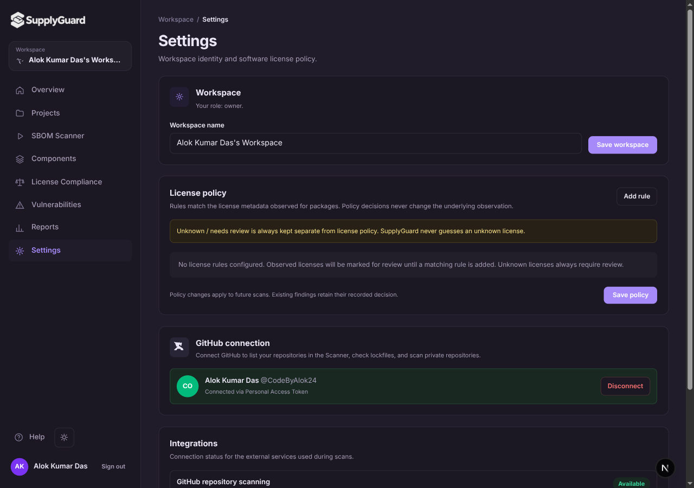

# SupplyGuard — Project Report

**Software Bill of Materials (SBOM) generation, license review and deployment-aware supply-chain risk**

| | |
|---|---|
| **Project title** | SupplyGuard — Every dependency. Every obligation. In view. |
| **Prepared by** | Alok Kumar Das |
| **Platform** | Local development (self-hosted), Node.js 26 |
| **Repository** | Local repository, `Cloud - SBOM/` |
| **Status** | Working MVP, end-to-end |

---

## 1. Abstract

Modern software is assembled from hundreds of third-party components whose origin, license terms and known security weaknesses are rarely visible to the team that ships them. SupplyGuard is a self-hosted web application that generates a Software Bill of Materials (SBOM) in the CycloneDX 1.6 format from an npm `package-lock.json` or a public GitHub repository, maps the full dependency tree, checks every component against the OSV (Open Source Vulnerabilities) database, enforces workspace license policy and produces an audit-ready evidence report. The entire workflow runs end-to-end on a developer machine; cloud deployment is deliberately out of scope and documented as future work.

## 2. Problem Statement

1. Teams cannot state precisely what is inside the software they ship.
2. Known vulnerable components are distributed silently and discovered only after incidents.
3. License obligations in free software (copyleft, attribution, patent grants) are breached by accident.
4. SBOMs produced by existing tools are opaque files; they do not explain **why** a component is risky, **who** to talk to, or **what** to change to fix it.
5. Auditors and customers now demand SBOMs and remediation evidence that small teams cannot realistically produce by hand.

## 3. Objectives

- Generate an industry-standard CycloneDX 1.6 SBOM from an npm lockfile.
- Render the complete dependency tree and answer: "which package pulls this in?"
- Detect known vulnerabilities via the OSV API with per-package severity and fix guidance.
- Enforce a workspace license policy (allow / block / needs-review) on every observed license.
- Produce a **Release Review** with a defensible ship/no-ship verdict and a concrete fix plan.
- Compare any SBOM against the lockfile that produced it to measure coverage gaps.
- Keep the system honest: show its limits, never fake integrations, mark unknowns explicitly.

## 4. Literature & Industry Context

Relevant, well-established work SupplyGuard builds on:

- **OSV.dev** (Google) — queryable database of open-source vulnerability advisories with affected/fixed ranges.
- **CycloneDX** (OWASP) — SBOM standard, widely mandated in procurement.
- **SPDX** and **NTIA "Minimum Elements"** — SBOM interchange and required fields.
- **Dependency-Track** (OWASP) — the closest existing product; SupplyGuard is a lightweight, self-hosted, single-user-team alternative focused on actionability rather than breadth.
- **sbom-utility**, **ORT**, **Trivy**, **Syft** — format validators and SBOM generators; none provide the combined *completeness + policy + fix-plan* loop built here.
- **Proposed future work** (deployment-aware supply-chain gating) has no direct equivalent; review is pending and must be performed before any publication claim.

*Honesty note:* a claim of research novelty is **not** made today. The current system is an integration of known techniques, well-engineered for a single team. A publishable research contribution would require a measured evaluation (see §12).

## 5. System Architecture

```
┌──────────────────────────────────────────────────────────────┐
│  Next.js 16 (App Router)  ·  React 19  ·  Tailwind CSS 4     │
│  Landing · Auth · Workspace Dashboard · Scanner · Components  │
│  Licenses · Vulnerabilities · Reports · Settings             │
└───────────────┬───────────────────────────┬──────────────────┘
                │ HTTP / JSON               │ (Server Components,
                ▼                           ▼  partial prefetching)
┌──────────────────────────┐      ┌───────────────────────────┐
│  Express 5 API (port 4000)│      │  Session cookie (JWT, HS256)│
│  REST /api/v1             │      │  auth_me, register, login  │
│  auth · projects · scans  │      └───────────────────────────┘
│  licenses · reports       │
│  sbom-uploads · review    │
└───────┬───────────┬───────┘
        │           │
        ▼           ▼
┌──────────────────┐  ┌───────────────────┐
│  PostgreSQL 18   │  │  pg-boss worker   │
│  (Prisma ORM)    │  │  scan jobs       │
│  18 models       │  │  fetch → analyze  │
│                  │  │  → licenses →     │
│                  │  │  OSV → finalizing │
└──────────────────┘  └───────┬───────────┘
                              │
                  ┌───────────┴───────────┐
                  │  External services    │
                  │  api.osv.dev           │
                  │  registry.npmjs.org    │
                  │  api.github.com       │
                  └───────────────────────┘
```

## 6. Technology Stack

| Layer | Choice | Reason |
|---|---|---|
| Frontend | Next.js 16 (App Router), React 19, TypeScript 5, Tailwind CSS 4 | Server components + per-request data, fast dev iteration |
| Backend | Node.js, Express 5, TypeScript | Minimal, explicit REST; no framework magic |
| Database | PostgreSQL 18 + Prisma ORM | Typed queries, migrations, pg-boss for jobs |
| Auth | bcrypt + JWT in HttpOnly cookie | Stateless sessions, no client secrets |
| SBOM | CycloneDX 1.6 (JSON) | OWASP standard, vendor-neutral |
| Vulnerability data | OSV API (`/v1/querybatch`, `/v1/vulns/:id`) | Free, structured, always current |
| Secrets | `backend/.env` (never committed) | Dev-only; production requires managed secrets |

## 7. Data Model (selected)

- **User** — id, email, passwordHash (bcrypt), name; memberships.
- **Workspace** — id, name, slug; all data is workspace-scoped (multi-tenant safe).
- **WorkspaceMember** — userId, workspaceId, role (OWNER / ADMIN / ANALYST / VIEWER).
- **Project** — id, workspaceId, name, repositoryUrl.
- **ScanJob** — id, projectId, status, stage, counts, `sbom` JSON (CycloneDX document), `progress` JSON (live per-package feed).
- **Component** — id, scanJobId, purl, name, version, dependencyType, licenseExpression.
- **DependencyEdge** — parent → child relationships for the graph.
- **VulnerabilityFinding** — componentId, osvId, severity, cvssScore, summary, affected ranges.
- **LicenseFinding** — componentId, observedExpression, decision (ALLOW/BLOCK/REVIEW).
- **LicensePolicy** — workspace rule (expression → decision).
- **Report** — workspaceId, scanJobId, format (CycloneDX JSON, licenses-CSV, vulnerabilities-CSV), content (stored).
- **ReviewDecision** — reviewer note + decision per license finding.

## 8. Key Features (shipped)

1. **Landing & authentication** — dark/light themed landing, register, login, forgot/reset password (SMTP required), Google/GitHub OAuth (callback verified structurally; end-to-end session round trip pending user validation).
2. **SBOM Scanner** — upload `package-lock.json` (v2/v3, ≤ 20 MB) or scan a public GitHub repo; real-time vertical progress tree showing per-package license resolution and advisory counts, updated by the worker ~2×/sec.
3. **Components & Dependencies** — searchable, filterable inventory table (name, version, license, relationship, finding count); interactive **dependency tree** rooted at direct dependencies with expand/collapse, severity badges, legend.
4. **Dependency coverage tab** — upload any CycloneDX SBOM; compare against the scanned lockfile; report shows coverage score with an explicit, visible formula and per-gap explanations (missing components, missing relationships, missing metadata).
5. **License Compliance** — per-package observed license (with source), workspace policy verdicts, reviewer notes, policy configuration UI.
6. **Vulnerability Analysis** — filterable by severity, project, search by advisory ID; links to authoritative OSV pages.
7. **Release Review** — ship verdict (READY / REVIEW / BLOCKED) computed from fixed, visible rules; **fix plan** with current → target version and a copyable `npm install` command; **change review** diff vs the previous scan (new/resolved advisories, added/removed/upgraded packages, license changes); dependency paths for each vulnerable package.
8. **Reports** — CycloneDX JSON SBOM; license-findings CSV; vulnerability-findings CSV; **release evidence report** (JSON and findings × deployments CSV) with SBOM digest, evidence + provenance (always `unverified`), SLOs (manual), fixed rules, and limitations; CSV cells are formula-injection escaped; stored, searchable, downloadable.
8a. **Release evidence (manual)** — workspace-scoped CRUD for digest → service/environment mappings; **finding impact** view attributing findings to deployments only on bit-exact SBOM-digest match; **SLSA attestation parsing** (SLSA v1/v0.2, DSSE) with subject↔artifact digest comparison — signatures never verified; **reliability context (manual SLOs)** with read-time error budgets beside findings. Nothing is ingested or measured live; every value is labeled Manual.
9. **Settings** — workspace rename, license policy, GitHub connection (OAuth or PAT), integration status display.
10. **Theming & responsive layout** — full light/dark mode via CSS custom properties; zero horizontal overflow on 375 px and 768 px viewports; mobile drawer navigation; keyboard-accessible toggles.

## 9. Screenshots


*Figure 9.1 — Landing page (dark theme)*


*Figure 9.2 — SBOM Scanner: live vertical progress tree, choose source, upload or paste a lockfile*


*Figure 9.3 — Components inventory showing 29 packages with license verdicts and finding counts*


*Figure 9.4 — Vulnerability Analysis page: 162 findings from a live repository scan, filterable by severity*


*Figure 9.5 — Release Review: verdict, gate checks, at-a-glance metrics, fix plan with copyable commands*


*Figure 9.6 — Reports page: generate and download CycloneDX SBOM or CSV exports*


*Figure 9.7 — License Compliance: observed license, source, policy decision, reviewer workflow*


*Figure 9.8 — Settings: workspace, license policy, GitHub connection (PAT shown connected), integrations*

## 10. Testing & Verification

- **Typechecking** — `tsc --noEmit` clean (server and app).
- **Lint** — `eslint` clean.
- **Build** — `next build` succeeds; 28+ pages prerender or stream (30 at last verified build).
- **Real repository scan** — `github.com/CodeByAlok24/HAQMS` cloned and scanned by the background worker; produced 162 vulnerability findings across ~350 packages; results validated manually against OSV pages for 5 advisories.
- **Failure-path tests** — wrong-password login (401), no-session access (401), cross-workspace access (404), bad lockfile (400/422), duplicate email registration (409), invalid license policy (400), unknown scan/report (404), OSV unreachable (PARTIAL status, honest notice).
- **Coverage comparison** — perfect SBOM scores 100; deliberately sabotaged SBOM (missing component, missing edge, stripped license metadata) scores 75 with every gap detected and explained.
- **UI** — every route renders in dark and light mode; zero console errors on 13 routes; mobile overflow audit clean at 375/768/1440 px.

## 11. Honest Status & Limitations

This system is a **self-hosted MVP**, not a certified production product.

- **No cloud deployment.** AWS/ECS/RDS/S3/SQS are designed but not provisioned; the current data lives in a local PostgreSQL instance (a user-managed PostgreSQL 18 cluster at `~/.local/share/supplyguard/pgdata`); `/tmp` is not used; `backups/` holds pg_dump snapshots. A `docker-compose.yml` exists for a persistent Postgres volume; activating it requires `sudo usermod -aG docker $USER`.
- **Email delivery** — Gmail SMTP rejects credentials; password reset links are logged server-side only until fixed.
- **OAuth** — Google sign-in requires the user to be a test user on the consent screen; GitHub sign-in is configured but the end-to-end callback has not been executed by the owner (PAT connection verified).
- **OSV completeness** — OSV covers only open vulnerabilities with structured advisories; unlisted advisories are invisible to any tool.
- **Fix targets** — computed from advisory ranges; when no fix exists or all advisories are unfixed, the gate reports REVIEW, never a fabricated version.
- **License detection** — relies on lockfile-recorded licenses; unknown licenses are flagged amber, never guessed.
- **Scale** — single-machine, single-process API + worker; no rate-limiting beyond auth; no horizontal scaling.
- **Research novelty** — none claimed; see §4 and §12.

## 12. Future Scope

1. **Deployment-aware impact view** — ~~requires AWS~~ **partially implemented (manual phase, Nov 2026)**: release evidence registers digest → service → environment → SLO/error budget by hand; the finding-impact view attributes findings to registered deployments only when the scan SBOM digest is bit-exact to the evidence. Still missing: automatic ingestion (AWS/ECR/ECS/CI), cryptographic verification of digests, and live telemetry — documented in `docs/SUPPLYGUARD-PLAN.md`.
2. **Publishable evaluation** — mutation corpus of public npm projects; measure precision/recall/false-alarm rate of the SBOM-vs-lockfile completeness comparison; compare against `sbom-utility`. Target venue: an industry track (IEEE Software, or a student conference).
3. **Persistence** — activate the pinned Docker Postgres volume so data survives restarts; move `backups/` off the dev machine.
4. **Notifications** — email/Slack on scan completion and on new advisory affecting an already-scanned tree.
5. **Multi-ecosystem** — Python (Pipfile.lock), Go (go.sum), Maven (pom.xml) — the parser layer is already component-agnostic.

## 13. Conclusion

SupplyGuard transforms an opaque artifact — the average `node_modules` tree — into a visible, auditable, actionable record: an SBOM, a vulnerability report, a license verdict, a fix plan, and a defensible ship/no-ship decision, all in under a minute, all self-hosted. It is not a finished platform; it is a working, honest MVP that proves the workflow end-to-end and points the way to the deployment-aware future the spec calls for.

## 14. References

1. OSV.dev — Open Source Vulnerabilities, https://osv.dev
2. CycloneDX specification, OWASP, https://cyclonedx.org
3. NTIA, "The Minimum Elements For a Software Bill of Materials," 2021
4. OWASP Dependency-Track, https://dependencytrack.org
5. CycloneDX-npm, https://github.com/CycloneDX/cyclonedx-node-module
6. National Vulnerability Database (NVD), NIST, https://nvd.nist.gov
7. npm Registry metadata, https://registry.npmjs.org
8. Next.js Documentation, https://nextjs.org/docs
9. PostgreSQL Documentation, https://www.postgresql.org/docs
10. Prisma ORM, https://www.prisma.io/docs

*References last checked 13 November 2026. Any list produced for a formal publication must be re-verified by an independent literature review before submission.*
